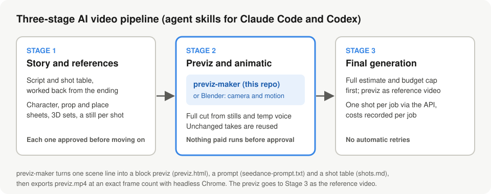
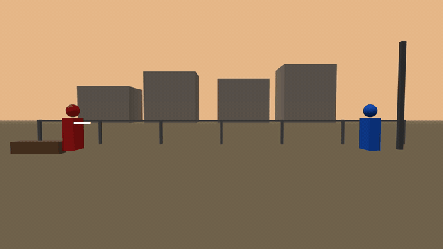
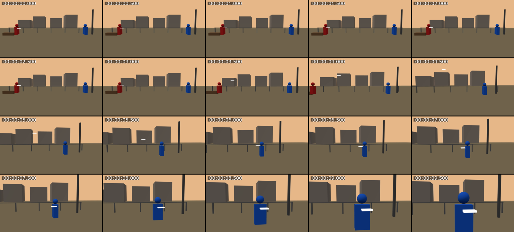

# previz-maker

[English](README.md) · 日本語

情景の一文、またはショットリストから、AI 動画生成（Seedance など）に渡す「動く参照」＝ブロックプレビズを作るエージェントスキルです。Claude Code と Codex で使えます。

作者: あつまだ（ATSUFUMI KASHIMA） / GitHub [@atsu-mada](https://github.com/atsu-mada)

## デモ動画

[ai& Build Day 応募デモ](https://youtu.be/JiEKbGYmS5E)（約3分、日本語のナレーションと字幕）：エージェントスキルで構築した AI 映像制作の3段階の工程と、その中での previz-maker の役割を紹介しています。

## パイプラインの中の位置



previz-maker は、エージェントスキルで構築した AI 映像制作の3段階の工程のうち、ステージ2で使うツールです。カメラと動きをプレビズで決め、有料生成の前に仮の動画で全編を確認します。ステージ3では、プレビズを参照動画として動画モデルに渡し、1ショット1ジョブで生成します。

## 例：1行からプレビズへ

入力（1行）：

> 夕暮れの空き地で、赤い服の子が投げた紙飛行機を、青い服の子が受け取って振り返る。



この実行で出力されたファイル：[previz.html](examples/paper-plane/previz.html)、[seedance-prompt.txt](examples/paper-plane/seedance-prompt.txt)、[shots.md](examples/paper-plane/shots.md)。書き出した previz.mp4 は240フレーム（24fps で10.000秒）です。

<details>
<summary>コマ一覧（0.5秒ごと）</summary>



</details>

## できること

毎回、次の3ファイルを作ります。

| ファイル | 中身 |
| --- | --- |
| `previz.html` | 箱と球だけの Three.js プレビズ。ブラウザで再生し、webm として録画できます |
| `seedance-prompt.txt` | 録画したプレビズを参照動画として渡すためのプロンプト |
| `shots.md` | ビートごとの画角・動作・カメラ・終了状態の表 |

見た目の完成度は追わず、カメラ、動線、立ち位置、タイミングだけを伝えます。

確認が済んだら、同梱の `scripts/render.mjs` で `previz.mp4` を書き出します。ヘッドレス Chrome で `previzSeek(秒)` を1フレームずつ呼んで描くので、尺とフレーム数が SCENE と正確に一致します（実時間の webm 録画も予備として残っています）。

```bash
node scripts/render.mjs <previz フォルダ> [--fps 24] [--size 1280x720]
```

テンプレートは既存の SCENE をそのまま動かしたまま、次の任意項目を使えます: 描画距離 `SCENE.far`（大きな球は自動で滑らかに描画）、白フェード `white` / `white-hold`、照明なしの単色 `basic: true`、ビートごとの進み方 `curve`、全面の色板 `SCENE.veil`、回り込み用の関数カメラ `beat.cam(t)`、ビート間の空の色の補間 `skyBlend`（既定はハードカット）。回り込み、スケールリビール、色によるマッチ転換などの汎用技法は SKILL.md にあります。

できた previz はスイートに依存しません。選んだスイートオペレーター（例: magnific-operator、tapnow-operator）が `@Video 1` として参照に上げます。利用者が previz を見て OK を出すまで、有料の生成には進みません。

## インストール

### Claude Code（プラグイン）

```
/plugin marketplace add atsu-mada/previz-maker-public
/plugin install previz-maker@atsu-mada-previz-maker
```

`/previz-maker:previz-maker` で呼び出せます。

### Claude Code（手動）

```bash
git clone https://github.com/atsu-mada/previz-maker-public.git ~/.claude/skills/previz-maker
```

`/previz-maker` で呼び出せます。

### Codex

```bash
git clone https://github.com/atsu-mada/previz-maker-public.git ~/.codex/skills/previz-maker
```

`$previz-maker` で呼び出せます。

### 必要なもの

- モダンブラウザ。Three.js は CDN（jsDelivr）から読み込みます。
- 確認用に `python3 -m http.server` を使います。
- mp4 書き出し（`scripts/render.mjs`）には次が必要です。
  - Node.js 22 以上（標準の fetch と WebSocket を使うので npm パッケージは不要）
  - Google Chrome または Chromium（見つからないときは `--chrome <パス>` か環境変数 `CHROME_PATH`）
  - ffmpeg（PATH 上、または環境変数 `FFMPEG`）。コンタクトシートの時刻表示には drawtext（freetype 付きのビルド）
  - 任意: `puppeteer-core` か `playwright` が import できればそちらを使い、無ければ Chrome DevTools Protocol を直接使います

## 関連スキル

- [ai-video-production](https://github.com/atsu-mada/ai-video-production-public) — 企画、参照シート、絵コンテ、カットプロンプトを作る前工程
- [seedance-studio](https://github.com/atsu-mada/seedance-studio-public) — Seedance 2.5 のプロンプト作成（Emily2040/seedance-2.0 の改変フォーク）

## 制限

- プレビズとプロンプトを作るだけです。Seedance などへの投入や動画生成は行いません。
- 箱と球だけの動き参照です。完成映像の見た目は扱いません。

## ライセンス

[MIT](LICENSE) © 2026 atsu_mada (ATSUFUMI KASHIMA)
