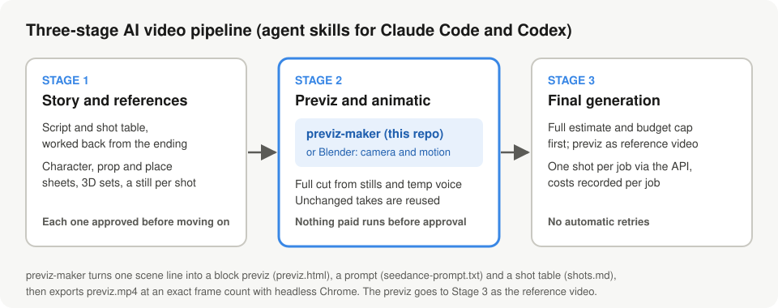
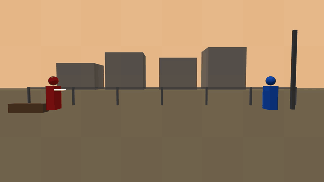
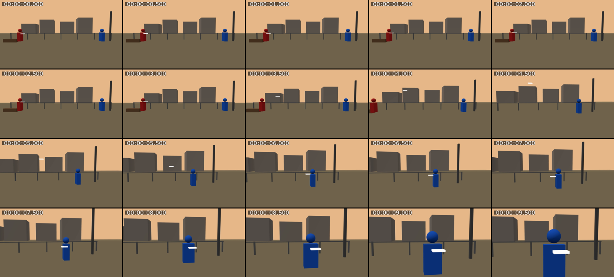

# previz-maker

English · [日本語](README.ja.md)

An agent skill that turns a one-line scene description or a shot list into a **block previz**: a moving reference to hand to AI video generation (Seedance and similar). Works with Claude Code and Codex.

Author: atsu_mada (ATSUFUMI KASHIMA) / GitHub [@atsu-mada](https://github.com/atsu-mada)

## Demo video

[ai& Build Day submission demo](https://youtu.be/JiEKbGYmS5E) (about 3 minutes, Japanese narration and subtitles): the three-stage AI video pipeline built with agent skills, and where previz-maker fits.

## Where it fits



previz-maker is the Stage 2 tool of a three-stage AI video pipeline built as agent skills. Camera and motion are settled in the previz, and the full cut is checked in an animatic before any paid generation. In Stage 3, the previz goes to the video model as the reference video, one shot per job.

## Example: one line to a previz

Input (one line, in Japanese):

> 夕暮れの空き地で、赤い服の子が投げた紙飛行機を、青い服の子が受け取って振り返る。
> (At dusk on an empty lot, the child in red throws a paper plane; the child in blue catches it and turns around.)



Outputs from this run: [previz.html](examples/paper-plane/previz.html), [seedance-prompt.txt](examples/paper-plane/seedance-prompt.txt), and [shots.md](examples/paper-plane/shots.md). The exported previz.mp4 has 240 frames (10.000 seconds at 24 fps).

<details>
<summary>Contact sheet (every 0.5 seconds)</summary>



</details>

## What it does

Every run produces these three files.

| File | Contents |
| --- | --- |
| `previz.html` | A Three.js previz made only of boxes and spheres. Plays in the browser and can be recorded as webm |
| `seedance-prompt.txt` | A prompt for passing the recorded previz as a reference video |
| `shots.md` | A per-beat table of framing, action, camera, and end state |

It does not aim for a finished look. It conveys camera, movement paths, positions, and timing only.

Once you have checked the previz, export `previz.mp4` with the bundled `scripts/render.mjs`. It calls `previzSeek(seconds)` frame by frame in headless Chrome, so the duration and frame count match the SCENE exactly (real-time webm recording remains available as a fallback).

```bash
node scripts/render.mjs <previz-dir> [--fps 24] [--size 1280x720]
```

Existing SCENE blocks keep working unchanged, and the template adds these optional features: draw distance `SCENE.far` (large spheres are drawn smoothly automatically), white fades `white` / `white-hold`, unlit flat colour `basic: true`, per-beat easing `curve`, a full-screen colour plate `SCENE.veil`, a function camera `beat.cam(t)` for orbits, and sky-colour interpolation between beats `skyBlend` (hard cuts by default). General techniques such as orbits, scale reveals, and colour match transitions are described in SKILL.md.

The previz does not depend on any suite. The suite operator you choose (for example magnific-operator or tapnow-operator) uploads it as the `@Video 1` reference. Paid generation does not start until the user has watched the previz and approved it.

## Install

### Claude Code (plugin)

```
/plugin marketplace add atsu-mada/previz-maker-public
/plugin install previz-maker@atsu-mada-previz-maker
```

Invoke with `/previz-maker:previz-maker`.

### Claude Code (manual)

```bash
git clone https://github.com/atsu-mada/previz-maker-public.git ~/.claude/skills/previz-maker
```

Invoke with `/previz-maker`.

### Codex

```bash
git clone https://github.com/atsu-mada/previz-maker-public.git ~/.codex/skills/previz-maker
```

Invoke with `$previz-maker`.

### Requirements

- A modern browser. Three.js is loaded from a CDN (jsDelivr).
- `python3 -m http.server` for previewing.
- mp4 export (`scripts/render.mjs`) needs:
  - Node.js 22 or later (it uses the built-in fetch and WebSocket, so no npm packages are required)
  - Google Chrome or Chromium (if it is not found, pass `--chrome <path>` or set `CHROME_PATH`)
  - ffmpeg (on PATH, or set `FFMPEG`). The contact sheet's timestamps need drawtext (a build with freetype)
  - Optional: `puppeteer-core` or `playwright` is used if importable; otherwise the script talks to the Chrome DevTools Protocol directly

## Related skills

- [ai-video-production](https://github.com/atsu-mada/ai-video-production-public) — the earlier stage: planning, reference sheets, storyboards, and cut prompts
- [seedance-studio](https://github.com/atsu-mada/seedance-studio-public) — Seedance 2.5 prompt authoring (a modified fork of Emily2040/seedance-2.0)

## Limitations

- It only creates the previz and the prompt. It does not submit to Seedance or other services, and it does not generate video.
- It is a motion reference made of boxes and spheres. It does not cover the look of the final footage.
- The skill instructions (SKILL.md) are written in Japanese.

## License

[MIT](LICENSE) © 2026 atsu_mada (ATSUFUMI KASHIMA)
